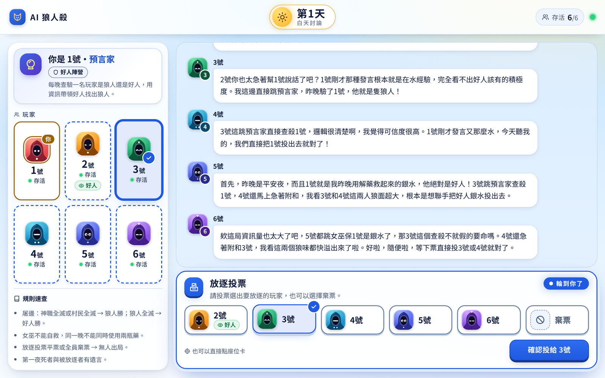
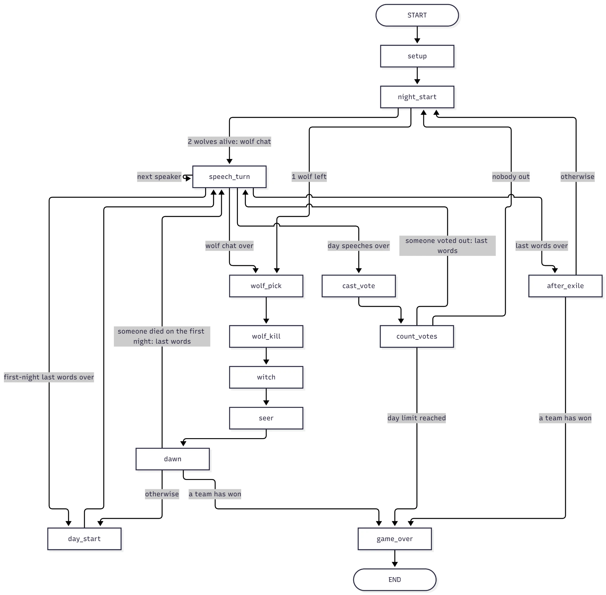

# AI Werewolf

A web version of Werewolf (狼人殺) for 6 players. You are the only human at the table. The other 5 players are AI players run by Gemini. The AIs are not told that a human is playing. Everyone just tries to help their own team win.

The whole game is built as a **LangGraph** graph: night, day, speeches, votes, and waiting for the human player are all steps in one graph. See [How the game uses LangGraph](#how-the-game-uses-langgraph). A **FastAPI** server connects the graph to the web page. The page and all AI speech are in Traditional Chinese.

We also worked a lot on the AI players. We improved them by editing their prompts, letting the AIs play hundreds of games against each other, and checking what changed. See [Prompt experiments](#prompt-experiments).

## Game rules

- **Players:** 2 werewolves, 1 seer, 1 witch, 2 villagers. Seats and roles are random, so you can get any role.
- **Night:** the werewolves pick someone to kill → the witch can save that person or poison someone (one potion of each per game) → the seer checks if one player is a werewolf.
- **Day:** everyone speaks once in seat order, then everyone votes to send one player out. You can skip your vote. A tie means nobody goes out.
- **Winning:** the good team wins when both werewolves are out. The werewolves win when both special roles (seer and witch) are dead, or both villagers are dead. After 10 days the game is a draw.
- Players are called only by seat number (「3號」). Roles stay hidden until the game ends.

## The game page

**Start page.** The board, the win rules and how a round goes. Press 「開始新遊戲」 to start.


**Playing.** On the left: your role card and the 6 seats. Seats show what you know, like your seer check results or your werewolf teammate. On the right: the game log. AI speech is typed out one character at a time, like a group chat. When it's your turn, a panel opens at the bottom: type your speech, vote, choose a target, or use the witch's potions. You can also click a seat card to choose it. If you are a werewolf, you also see the night-time wolf chat.

In this game, 3號 (an AI werewolf) pretends to be the seer and says the human seer is a werewolf. Then 5號 (the AI witch) says she saved 1號 last night, so 1號 must be good.



**Game end.** Every role is revealed, along with each AI's personality.


**God's-eye review.** The full game: every night action, plus each AI's private thought (「內心」) before each speech and action. Here you can see why the wolf decided to lie, and how the witch worked it out.


If you reload the page during a game, press 「繼續上一局」 to continue. Every finished game is saved to `games/` as a JSON file.

## How the game uses LangGraph

One game is one LangGraph `StateGraph` ([werewolf/graph.py](werewolf/graph.py)). Each part of the game is a node, and the edges decide what comes next.



The Mermaid source of this diagram is in [docs/graph.mmd](docs/graph.mmd).

`speech_turn` lets one player speak at a time and loops back to itself until everyone in the queue has spoken. The same node handles the wolf chat, day speeches and last words.

| LangGraph feature | How the game uses it |
|---|---|
| `StateGraph` with a typed state | One `GameState` holds players, day, phase, potions, seer checks and the event log ([state.py](werewolf/state.py)). The event log uses a reducer (`operator.add`), so each node only returns its new events. |
| Conditional edges | Pick the next node, e.g. after `dawn`: end the game if a team has won, otherwise start the day. After every node that calls the AI, the game also goes to `game_over` if the token budget is used up. |
| `interrupt()` | On the human's turn, the node pauses the graph. The server sends the question to the page over a WebSocket. |
| `Command(resume=...)` | When the player answers, the server continues the graph with that answer. |
| `Send` | For votes and the wolves' kill, the graph sends one `Send` per player, so `cast_vote` / `wolf_pick` run for all players at the same time. The human's run waits on `interrupt()` while the AI runs finish. |
| Checkpointer (`InMemorySaver`) | Saves the state after every step. This is what lets the game stop and wait for the human, then continue from the same place. Each game has its own `thread_id`. |
| `astream` + `get_stream_writer()` | The server streams each node's new events to the page as they happen. Nodes also stream status text, like 「夜晚行動中…」. |

Self-play uses the same graph without a human: every seat is an AI, so nothing interrupts and `graph.ainvoke()` runs the game to the end.

One lesson: when the graph resumes after `interrupt()`, LangGraph runs that node again from the top. So each node calls `interrupt()` first, before any AI call or random choice. Otherwise the AI call or the random choice would run a second time.

## How the AI players work

Each AI action is one Gemini call (default model `gemini-3.5-flash-lite`). The answer is structured: a private `thought`, plus either a `speech` or a `target` seat. The `thought` is never shown to other players. You only see it in the review.

Each call's prompt has three parts:

1. **System prompt.** The AI's seat and role, plus fixed text from `werewolf/prompts/text/`:
   - `rules.md`: game rules and common Werewolf terms
   - `roles/<role>.md`: a strategy guide for each role. This is the file we changed the most.
   - `personas/<name>.md`: a speaking style (optional)
   - `output_rules.md`: how to speak (short, casual, Traditional Chinese, never say "I am an AI")
2. **Game log.** Only what this seat is allowed to know (`knowledge.py`). A villager never sees the wolf chat or someone else's check result.
3. **Task.** What to do now (speak, vote, kill, check, use a potion), with short hints from `builders.py`.

The code also checks every answer. An illegal choice is retried or replaced with a random legal one. Each game also has a token budget.

**Personalities.** Each AI gets one of 4 speaking styles, or none: analyst (邏輯分析派), leader (強勢帶節奏), chill (佛系隨緣), skeptic (疑心病重). They only change the tone, not the strategy. To add a new one, add a file to `personas/`.

## Prompt experiments

### How we tested

- **Self-play:** all 6 seats are AI. Each version plays 50 games, 10 at a time. Each run saves its games and a copy of the prompt files it used to `games/ai_only/<name>/`.
- **One change at a time:** each step changes only one team's role guides. Then we compare the win rate with the step before.
- **Read the thoughts:** in lost games we read the AIs' private thoughts to find out *why* they lost. That told us what to change next.
- **Fixed seeds** (from step 3): both versions get the same seats and roles in game *i*, so we can compare them game by game.

### Results

The two teams took turns, like an arms race: each step answers the other team's newest version.

| Step | Team | What we changed | Result |
|---|---|---|---|
| 1. wolf-v2 | Wolves | Plan roles in the wolf chat. Pretend to be the seer when the real seer finds you. Drop a teammate who is about to be voted out. Use the good team's reasoning mistakes. | Wolf win rate **48% → 76%** |
| 2. good-v2 | Good | Add basic facts: the player the witch saved is good, and a quiet night means the witch saved someone. Judge claims by hard evidence, not by tone. Vote together. The seer checks a random player on the first night. | Good win rate **24% → 54%** |
| 3. wolf-v3 | Wolves | Stop pretending to be the seer. Act like the most loyal good player. Never vote for the seer or witch. Fixed kill order: seer on night 2, witch on night 3. | Wolf win rate **46% → 74%** |
| 4. good-v3 | Good | The witch must poison on night 2 and reveal herself on day 1. Everyone lists the confirmed good players, so the wolves must be among the rest. Never skip a vote. | Good win rate **26% → 64%** |
| 5. wolf-v4 | Wolves | New kill rule: go for the last villagers instead of the seer. | Wolf win rate 36% → 44% (not significant) |
| 6. wolf-v5 | Wolves | The same kill rule in simpler words. | Wolf win rate 36% → 44% (not significant) |
| 7. persona-v1 | Both | Give each AI one of the 4 personalities. | Wolf win rate about the same (44% → 42%) |

### What we learned

- **"Must" works, "can" doesn't.** The first wolf prompt said wolves *can* pretend to be the seer. The AI almost never did. A clear rule, with the reason behind it, changed what the AI did.
- **The thoughts show the real problem.** Many good-team losses came from reasoning mistakes, not bad luck. For example: "the player the witch saved can't be the seer". Writing the correct facts into the prompt fixed most of them.
- **A strategy only works against one opponent.** Pretending to be the seer worked well in step 1. After the good team learned "a player who claims seer only after being found is a wolf", it became a losing move, so step 3 removed it.
- **The AI copies keywords but skips conditions.** In step 5 the wolves misread the new kill rule. In step 6 they saw "kill the player who claimed seer" and did it, even when the rule's condition said to kill a villager. If they had followed the rule, the wolves would win about 70% of games.
- **Some losses come from the board, not the prompt.** When the witch dies on the first night, the good team almost never wins (0 of 14 games in step 4).
- **Personality matters.** The skeptic hurt whichever team it played for (wolf win rate 31% as a wolf, good win rate 50% as a good player). The leader played the witch best, and the analyst played the seer best. Each group had only 9–56 seats, so these numbers are rough.

The full reports (in Chinese) are in [`report/`](report/), one per step, from [`step01_wolf-v2.md`](report/step01_wolf-v2.md) to [`step07_persona-v1.md`](report/step07_persona-v1.md).

## Run it

You need [uv](https://docs.astral.sh/uv/). It installs Python and all dependencies.

```bash
uv sync
```

Create `.env` in the project root:

```
gemini_key=your-gemini-api-key
WEREWOLF_PASSWORD=your-password
```

`WEREWOLF_PASSWORD` is optional. Set it if other people can reach your server; otherwise anyone with the link can use up your API credits. Without an API key, the game falls back to offline AIs that make random moves.

Start the server and open <http://127.0.0.1:8000>:

```bash
uv run python -m werewolf
```

| To | Command |
|---|---|
| Let other computers connect | `uv run python -m werewolf --host 0.0.0.0` |
| Play offline (random AI, no API calls) | `uv run python -m werewolf --fake` |
| Use another model | `WEREWOLF_MODEL=model-name uv run python -m werewolf` |
| Run self-play (all AI, no browser) | `uv run python -m werewolf.selfplay --games 50 --concurrency 10 --seed 1000 --name my-test` |
| Self-play with personalities | add `--persona mix` |
| Play from outside with a public https link | `cloudflared tunnel --url http://localhost:8000`, then open `<link>/?key=<password>` |
| Run the tests (no API calls) | `uv run pytest` |

Other settings: `WEREWOLF_TOKEN_BUDGET` (most tokens one game can use, default 1,200,000) and `WEREWOLF_SPEECH_PAUSE` (seconds to wait after each AI speech, default 2).

## Project layout

```
werewolf/
  graph.py       game flow as a LangGraph graph; pauses with interrupt() on the human's turn
  state.py       GameState (the graph's state), events, and who can see each event
  rules.py       game rules: dealing roles, night results, vote counting, win checks
  ai.py          Gemini calls: structured output, retries, legal-move checks, token budget
  server.py      FastAPI + WebSocket server, one session per game
  selfplay.py    all-AI games for testing prompts
  prompts/
    text/        all prompt text (rules, role guides, personalities); edit here
    knowledge.py what each seat is allowed to know
    builders.py  puts the system prompt, game log and task together
static/          the web page (plain HTML/CSS/JS, no build step)
report/          prompt experiment reports (in Chinese)
tests/           pytest tests
```
